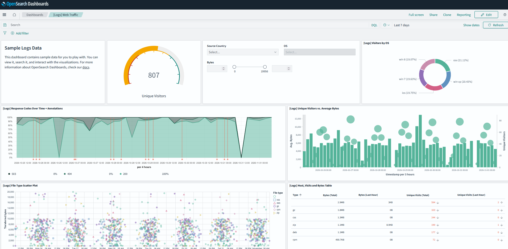
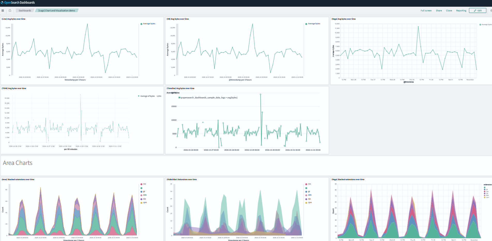
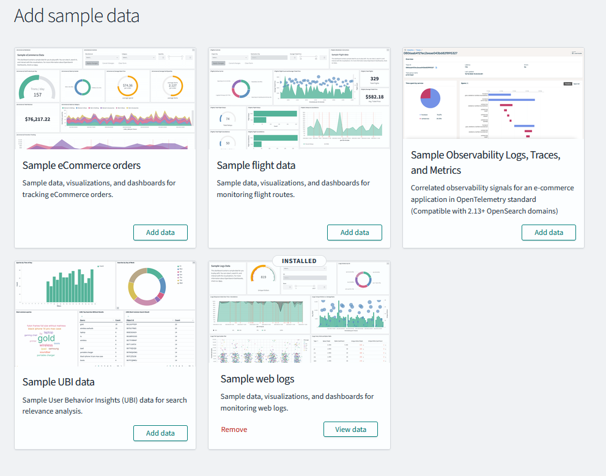
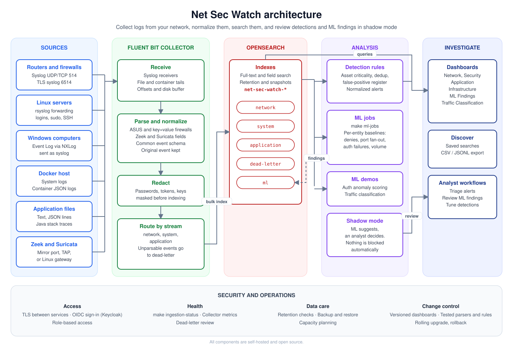
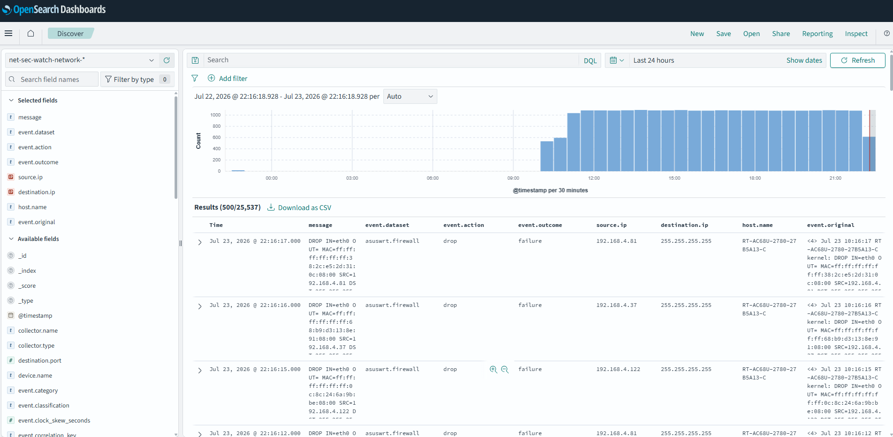

# Net Sec Watch

Net Sec Watch is an open-source, self-hostable SIEM-style platform for
collecting, normalizing, searching, dashboarding, and analyzing security logs
from routers, firewalls, Linux servers, Windows computers, application files,
containers, and optional network sensors.

Author: SJ du Preez



| Charts over time | Sample data sets |
| --- | --- |
|  |  |

These screenshots use the web log sample data that ships with OpenSearch
Dashboards (**Home → Add sample data**). Your own logs work with the same
search, charts, and dashboards.

## What you can do with it

- Pull logs from routers, firewalls, and other syslog devices, Linux servers,
  Windows computers, application log files, Docker containers, and Zeek and
  Suricata traffic sensors.
- Normalize events into a consistent security schema while keeping the original
  raw event for investigation.
- Search events in OpenSearch and view them in OpenSearch Dashboards.
- Add saved searches, filters, dashboards, and analyst views.
- Run deterministic security detections and produce normalized alerts.
- Test machine-learning and self-learning traffic-analysis workflows in
  governed shadow mode before trusting automation.
- Run locally with Docker Compose, or use the deployment artifacts for Linux VM
  and Kubernetes-style environments.

This README gives the short path from install to usable platform. Deeper
references are linked throughout and collected in [docs/index.md](docs/index.md).

## How the platform fits together



| Stage | What happens | More |
| --- | --- | --- |
| Sources | Routers, firewalls, Linux servers, and Windows computers send syslog. The collector also reads Docker host, container, and application log files, and Zeek and Suricata sensor logs | [Connect your network](docs/guides/ingestion.md) |
| Fluent Bit collector | Receives and tails logs, parses known formats into a common schema, keeps the original event, masks secrets, and routes each event to its stream. Events it can't parse go to dead-letter | [Event normalization](docs/event-normalization-pipeline.md) |
| OpenSearch | Stores events in `net-sec-watch-network`, `-system`, `-application`, `-dead-letter`, and `-ml` indexes with retention and snapshots | [Search and dashboards](docs/guides/search-and-dashboards.md) |
| Analysis | Detection rules produce normalized alerts. ML jobs compare each IP or host with its own history and write findings to the `ml` index. Everything runs in shadow mode: ML suggests, an analyst decides | [Detections](docs/security-detections-alerting.md), [machine learning](docs/guides/machine-learning.md) |
| Investigate | Dashboards, Discover, saved searches, CSV or JSONL export, and analyst workflows | [Analyst workflows](docs/analyst-workflows.md) |
| Security and operations | TLS, OIDC sign-in with Keycloak, role-based access, ingestion health, backup and restore, and capacity planning | [Security](docs/guides/security.md), [operations](docs/guides/operations.md) |

Default local ports:

| Service | URL or port | Purpose |
| --- | --- | --- |
| Syslog UDP/TCP | `514` | Router, firewall, and device log ingestion |
| Syslog TLS | `6514` | Encrypted syslog ingestion |
| Fluent Bit health | `http://127.0.0.1:2020/api/v1/health` | Collector health check |
| OpenSearch | `http://127.0.0.1:9200` | Search API |
| OpenSearch Dashboards | `http://127.0.0.1:5601` | Browser UI |

## Quick start

Install Docker with Compose v2, Git, Python 3, Bash, curl, and OpenSSL.
On Windows, run in Ubuntu WSL2 with Docker Desktop integration turned on.

```bash
git clone https://github.com/Buglish/net-sec-watch.git
cd net-sec-watch
python3 scripts/setup.py --demo --ml     # or: make setup-ml
```

This one command starts collection, search, and dashboards. It also imports the
default dashboards, sends sample logs, and loads the ML demo. Open the printed
URL and set **Last 24 hours**. **Net Sec Watch - Network** shows the sample
logs, and **Net Sec Watch - Traffic Classification** shows the ML results. If
setup reports an error, fix it and rerun the command. Existing data is kept.

| Goal | Command |
| --- | --- |
| Everything, including the ML demo (recommended first run) | `make setup-ml` |
| Stack and sample logs, without ML | `make dashboard-demo` |
| Stack only, for real log sources | `make setup` |
| ML scoring without Docker | `make ml-demo` |
| ML on your real logs (after logs arrive) | `make ml-jobs` |
| Check installed tools and Docker | `make doctor` |
| Stop and keep data | `make down` |

Step-by-step instructions and troubleshooting:
[getting started](docs/guides/getting-started.md). How the ML features work and
how to use your own data: [machine learning](docs/guides/machine-learning.md).

## Demo dashboards you can open

After setup, open <http://127.0.0.1:5601> and use
**Dashboards**:



| Dashboard | Shows |
| --- | --- |
| `Net Sec Watch - Network` | Router, firewall, denied traffic, and suspicious network records |
| `Net Sec Watch - Security` | Cross-domain authentication, network, and parser triage |
| `Net Sec Watch - Application` | Application errors and failed outcomes |
| `Net Sec Watch - Infrastructure` | Authentication failures and collection quality |
| `Net Sec Watch - ML Findings` | ML findings from your real logs, after `make ml-jobs` |

After `make setup-ml`, **Net Sec Watch - Traffic Classification** also
shows the ML demo results.

## Manual setup path

Use this if you want to run each step yourself:

```bash
make init
make check
make up
make up-dashboards
make import-dashboards
make generate
./scripts/send-demo-syslog.sh
```

Then open `http://127.0.0.1:5601`, go to **Discover**, select
`net-sec-watch-network`, and search for `NetSecWatchDemo001`.

## Connect your own data

Net Sec Watch doesn't fetch logs. You point each source at it. Send syslog
to the Docker host's LAN IP on port 514, for example `192.168.1.209:514/UDP`.
Don't use a `172.x.x.x` Docker or WSL address.

| Source | How to connect | Guide section |
| --- | --- | --- |
| Routers, firewalls, switches | Set the device's remote syslog server to the host IP, port 514, BSD/RFC 3164 format. Steps for ASUS, pfSense, OPNsense, FortiGate, UniFi, Meraki, MikroTik, OpenWrt, and Cisco IOS | [Router or firewall syslog](docs/guides/ingestion.md#1-router-or-firewall-syslog) |
| Linux servers | Forward with rsyslog to TCP 514 | [Linux servers](docs/guides/ingestion.md#2-linux-servers) |
| The Docker host itself | Set `HOST_LOG_ROOT=/var/log` and `CONTAINER_LOG_ROOT=/var/lib/docker/containers` in `.env`, then `make up` | [Logs on the Docker host](docs/guides/ingestion.md#3-logs-on-the-docker-host) |
| Windows computers | Forward the Event Log with an agent such as NXLog | [Windows computers](docs/guides/ingestion.md#4-windows-computers) |
| Application log files | Mount the log folder in `compose.override.yaml`, or send syslog | [Application log files](docs/guides/ingestion.md#5-application-log-files) |
| Network traffic | Run Zeek or Suricata on a switch mirror port, TAP, or Linux gateway (see [section 5](#5-optional-sensors-zeek-and-suricata)) | [Traffic sensor](docs/guides/ingestion.md#6-traffic-sensor-zeek-and-suricata) |

Run `make ingestion-status` to check that each stream is receiving events.
The [connect your network](docs/guides/ingestion.md) guide covers firewall
ports, a test message, which device formats are parsed into fields, and
troubleshooting.

## 1. Add a search, filter, or dashboard

**Requires:** a running Dashboards UI with saved objects imported. The easiest
path is `make dashboard-demo`; the manual path is `make up-dashboards` followed
by `make import-dashboards`.

The simple workflow is:

1. Open **Discover** in OpenSearch Dashboards.
2. Build a search using filters, for example:

   ```text
   event.kind:alert OR log.syslog.severity.name:(warning OR error)
   ```

3. Save it as a saved search.
4. Open **Dashboard**.
5. Add the saved search or add visualizations.
6. Export the saved object if you want it managed in Git.
7. Store managed dashboard objects under `config/dashboards/`.

Existing dashboard assets live here:

| Path | Purpose |
| --- | --- |
| `config/dashboards/data-views-v1.ndjson` | Data views |
| `config/dashboards/saved-searches-v1.ndjson` | Saved searches |
| `config/dashboards/dashboards-v1.ndjson` | Dashboard layouts |
| `config/dashboards/search-examples-v1.json` | Example analyst searches |
| `config/dashboards/managed-saved-objects-v1.ndjson` | Managed saved objects |

Run dashboard checks:

```bash
make test-opensearch-dashboards
make test-dashboards-reproducibility
```

## 2. Add filters and parsing logic

**Requires:** nothing running — this is config editing. `make test-golden`
needs only `python3`; `make test-integration` needs Docker to replay real
events through the changed config.

Use filters when you need to enrich, redact, normalize, or route events.

Main places to edit:

| Path | Purpose |
| --- | --- |
| `config/fluent-bit.conf` | Main collector pipeline |
| `config/fluent-bit.local.conf` | Local overrides |
| `config/parsers-custom.conf` | Custom parsers |
| `config/scripts/canonical_normalization.lua` | Common normalized fields |
| `config/scripts/network_normalization.lua` | Network field normalization |
| `config/scripts/sensitive_redaction.lua` | Redaction of sensitive values |
| `config/scripts/syslog_metadata.lua` | Syslog enrichment |
| `config/schema/canonical-event-schema-v1.json` | Expected event shape |

Good rule of thumb:

- Parse as little as needed at the input edge.
- Keep `event.original` so investigations can always see the raw source log.
- Route bad events to dead-letter instead of silently dropping them.
- Add tests when changing parsing behavior.

Useful validation:

```bash
make test-golden
make test-integration
make test-opensearch-searchability
```

## 3. Use detections and alerts

**Requires:** nothing running — `scripts/run-detections.py` evaluates a
JSONL file of events directly (`--events`), no OpenSearch connection needed.
Wire alerts into Dashboards once you have real ingested data to search over.

Detection content is under `config/detections/`.

Important files:

| Path | Purpose |
| --- | --- |
| `config/detections/rules-v1.json` | Detection rules |
| `config/detections/alert-schema-v1.json` | Normalized alert shape |
| `config/detections/detection-use-cases-v1.json` | Use-case mapping |
| `config/detections/asset-criticality-v1.json` | Asset importance |
| `config/detections/source-confidence-v1.json` | Source confidence scoring |
| `config/detections/dedup-suppression-v1.json` | Alert suppression policy |
| `config/detections/false-positive-register-v1.json` | Analyst-approved false positives |
| `config/detections/notification-destinations-v1.json` | Alert destination contracts |

Run detection validation:

```bash
make test-detections
```

Use detections with dashboards by filtering for alert fields, detection rule
names, severity, asset criticality, or source confidence. Keep detections
source-agnostic where possible so the same rule can work across router,
firewall, Zeek, Suricata, and host events.

## 4. Machine learning

**Requires:** the running stack with real logs for ML jobs. The demos need
only sample data.

| Feature | Run | Results |
| --- | --- | --- |
| **ML jobs on your real logs**: firewall denies, port scans, auth failures, and log volume per IP or host, each compared with its own history | `make ml-jobs` (or `--every 10` to keep running) | **Net Sec Watch - ML Findings** dashboard |
| Authentication anomaly scoring (real statistics, works on your own data) | `make ml-demo` | Terminal and `runtime/demos/ml/` |
| Traffic classification and candidate models (simulated workflow) | `make setup-ml`, or `make traffic-classification-demo` on a running stack | **Net Sec Watch - Traffic Classification** dashboard |

Both run in shadow mode. They suggest, an analyst decides, and nothing is
blocked or promoted automatically:

```text
ML suggests -> analyst reviews -> detection is tuned -> automation is approved later
```

Job templates live in `config/ml/jobs/`. Copy one to add your own use case,
such as a different query, entity, or metric. The
[machine learning guide](docs/guides/machine-learning.md) covers the
templates, scheduling, reading findings, the demos, and validation
(`make test-ml`). ML policy lives in `config/ml/` and `config/orchestration/`.

## 5. Optional sensors: Zeek and Suricata

**Requires:** `ZEEK_INTERFACE`/`SURICATA_INTERFACE` set in `.env` to a real
mirrored, tapped, or gateway interface before starting — the containers need
host networking and packet-capture capabilities, so this doesn't work against
a plain loopback/no interface.

Enable Zeek:

```bash
make up-zeek
```

Enable Suricata:

```bash
make up-suricata
```

Update Suricata rules:

```bash
make update-suricata-rules
```

Set the monitored interface in `.env`, for example:

```text
ZEEK_INTERFACE=eth0
SURICATA_INTERFACE=eth0
```

These sensors may need host networking and elevated packet-capture
capabilities, so test them in a lab before using them on a real network.

## 6. Security profile

**Requires:** `make gen-tls-certs` first (generates local self-signed TLS
material into `config/tls/`). `up-identity` reuses the `opensearch`/
`opensearch-dashboards` container names, so Compose recreates them in place
with TLS enabled if a plain `up-dashboards` stack is already running — no
need to stop it manually first.

For a more realistic secured stack:

```bash
make gen-tls-certs
make up-identity
make test-oidc
```

Security-related assets:

| Path | Purpose |
| --- | --- |
| `config/opensearch-security/` | Roles, mappings, OIDC, and audit config |
| `config/security/` | License, data classification, and review evidence |
| `config/tls/` | Local generated TLS material |
| `docs/guides/security.md` | Security guide |

Never commit real secrets. Use `.env.example` and other `*.example` files for
safe documentation, and keep real local config ignored by Git.

## 7. Audit open-source libraries and images

**Requires:** nothing running — these are one-shot `audit`-profile
containers (`syft`/`grype`) invoked via `scripts/security-audit.sh`, not a
persistent stack.

The project includes SBOM and audit-oriented Compose profiles using open-source
tools such as Syft and Grype.

Typical audit files should be stored under:

```text
security/audits/
```

Use clear filenames that include the target and date, for example:

```text
security/audits/sbom-source-2026-07-09.spdx.json
security/audits/sbom-fluent-bit-2026-07-09.spdx.json
security/audits/grype-fluent-bit-2026-07-09.json
```

See [docs/guides/security.md](docs/guides/security.md) for the detailed audit
workflow.

## 8. Validate the application

Run everything:

```bash
make check
```

Focused checks:

```bash
make test-security
make test-operations
make test-detections
make test-ml
make test-deployment
make test-orchestration
```

OpenSearch and dashboard checks:

```bash
make test-opensearch
make test-opensearch-secure
make test-opensearch-searchability
make test-opensearch-dashboards
```

## Documentation map

- [Documentation index](docs/index.md)
- [Feature status and remaining work](docs/features-and-roadmap.md)
- [Administrator guide](docs/guides/admin-guide.md)
- [Getting started](docs/guides/getting-started.md)
- [Machine learning](docs/guides/machine-learning.md)
- [Configuration](docs/guides/configuration.md)
- [Connect your network](docs/guides/ingestion.md)
- [Search and dashboards](docs/guides/search-and-dashboards.md)
- [Security](docs/guides/security.md)
- [Operations](docs/guides/operations.md)
- [Deployment](docs/guides/deployment.md)
- [Add-ons and special features](docs/guides/addons-and-special-features.md)
- [Developer testing](docs/guides/developer-testing.md)

Detailed implementation notes remain under docs, and validation evidence remains
under docs/test-results for traceability.

## Production readiness

Net Sec Watch is usable for local development, lab validation, syslog
collection, OpenSearch search/dashboards, deterministic detection testing, and
simulated ML/adaptive workflows.

Before using it as a production security system, complete the real-world
evidence listed in [docs/features-and-roadmap.md](docs/features-and-roadmap.md):
live source validation, target-user usability testing, performance and
resilience evidence, clean-environment deployment evidence, and release
tagging.

## License

MIT. See [LICENSE](LICENSE).
